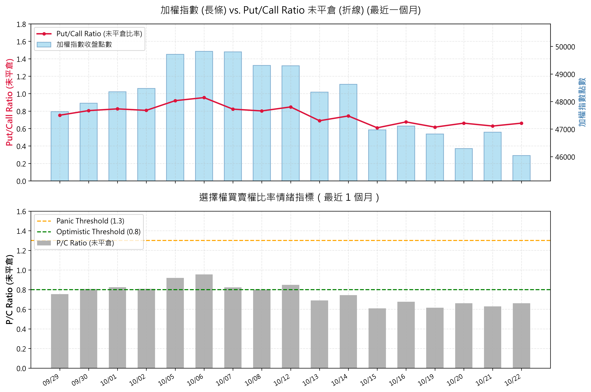

# 台股加權指數 × 選擇權 Put/Call Ratio 情緒分析

使用 Python 自動抓取**期交所選擇權 Put/Call Ratio(未平倉比率)**與**台股加權指數**,合併近期資料後,繪製成雙圖表,觀察市場多空情緒與指數走勢的關係,並自動輸出圖檔與整理後的 CSV。

## 圖表預覽



- **上圖**:加權指數收盤點數(長條,右軸)與 Put/Call Ratio(折線,左軸)疊圖
- **下圖**:Put/Call Ratio 長條圖,搭配 1.3 與 0.8 兩條參考線

---

## 功能

- 自動抓取期交所開放資料 API 的 Put/Call Ratio
- 自動抓取 Yahoo Finance 的加權指數(`^TWII`)歷史收盤價
- 以日期合併兩份資料,取最近最多 30 個交易日
- 繪製雙軸複合圖與情緒指標圖(共用 X 軸日期)
- 自動儲存圖表(`images/`)與清理後的資料(`data/`)

---

## 資料來源

| 資料 | 來源 |
|------|------|
| Put/Call Ratio | [臺灣期貨交易所開放資料 API](https://openapi.taifex.com.tw/)(`/v1/PutCallRatio`) |
| 加權指數 | Yahoo Finance(透過 `yfinance` 套件,代號 `^TWII`) |

---

## 技術架構

| 類別 | 使用技術 |
|------|----------|
| 語言 | Python 3 |
| 資料處理 | pandas |
| 資料取得 | requests、yfinance |
| 視覺化 | matplotlib |

---

## 專案結構

```
├── main.py              # 主程式:抓資料、合併、繪圖、輸出
├── requirements.txt     # 套件清單
├── images/
│   └── taiex_pcr_analysis.png   # 執行後產生的圖表
└── data/
    └── taiex_pcr_30days.csv     # 執行後產生的整理資料
```

---

## 安裝與執行

```bash
# 1. 下載專案後,安裝套件
pip install -r requirements.txt

# 2. 執行
python main.py
```

執行後會在 `images/` 與 `data/` 資料夾產生圖表與 CSV(資料夾不存在會自動建立)。

> 需要網路連線。圖表中文字型預設使用 **Microsoft JhengHei(微軟正黑體)**,
> 若在 macOS / Linux 執行,請將 `main.py` 中的 `plt.rcParams["font.sans-serif"]` 改成系統有的中文字型,否則中文會顯示成方框。

---

## 指標說明

**Put/Call Ratio(未平倉比率)** = 賣權未平倉量 ÷ 買權未平倉量。期交所 API 提供的是百分比數值,程式中除以 100 轉換為倍數。

- 比值偏高:市場避險(買賣權中賣權比重高)的氣氛較濃
- 比值偏低:市場偏樂觀
- 圖中 **1.3** 與 **0.8** 為自訂的參考線,僅作為視覺上的情緒區間參考,**不構成投資建議**

---

## 已知限制

- 實際取得的資料筆數取決於期交所 API 提供的範圍,可能少於 30 個交易日
- 以公開 API 抓取,若 API 格式或欄位名稱變動,程式需要跟著調整
- 目前僅觀察單一時間區間,尚未做相關性統計或回測

## 未來規劃

- [ ] 計算 Put/Call Ratio 與指數漲跌的相關係數
- [ ] 加入更長的時間區間與可調整的參數
- [ ] 改成互動式圖表

---

## 作者

- 姓名:Roux
- Email:rouxchen.code@gmail.com

---

*此專案為個人學習與作品集用途,僅供資料分析與視覺化練習,不構成任何投資建議。*
